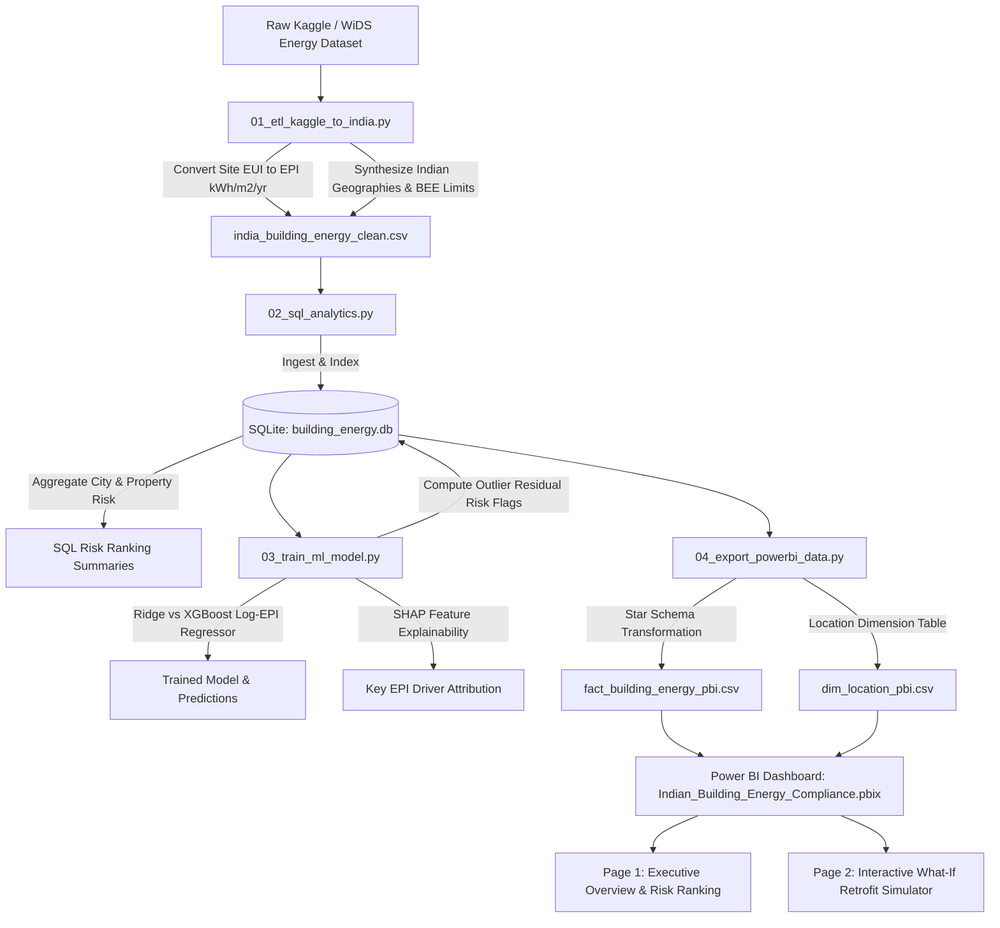

# Indian Commercial Building Energy Efficiency & Regulatory Compliance Analytics

[](https://www.python.org/)
[](https://www.sqlite.org/)
[](https://xgboost.readthedocs.io/)
[](https://shap.readthedocs.io/)
[](https://powerbi.microsoft.com/)
[](LICENSE)

---

## 📌 Executive Summary

Rapid urbanization and climate-sensitive commercial growth across India have created massive operational energy footprints. Under the **Bureau of Energy Efficiency (BEE)** framework and the **Energy Conservation Building Code (ECBC)**, commercial establishments face strict **Energy Performance Index (EPI)** ceilings. 

This enterprise analytics repository models energy compliance and economic exposure across **26,513 commercial buildings** spanning major Indian metropolitan centers and varied climate zones (Warm & Humid, Hot & Dry, Composite, Moderate).

### Key High-Level Findings
* **Total Commercial Buildings Assessed:** 26,513 facilities
* **Regulatory Non-Compliance Rate:** **61.02%** (16,179 buildings breach BEE Star 1 baseline limits)
* **Modeled Regulatory Penalty Exposure:** **₹22,134.65 Crores** (computed at ₹3.50/kWh excess penalty tariff)
* **Highest Exposure City:** **Hyderabad** (₹13,092.48 Cr across 11,920 commercial assets)
* **Most Vulnerable Asset Class:** **Hospitals** (average actual EPI of 767.67 kWh/m²/year vs. 300 baseline ceiling; 91.2% non-compliance) and **Commercial Offices** (₹16,752.85 Cr total penalty liability)

---

## 🏛️ Analytical Architecture & Pipeline Flow



---

## 💻 Tech Stack & Tooling

| Domain | Technology / Library | Application |
| :--- | :--- | :--- |
| **Data Ingestion & ETL** | `Python`, `pandas`, `NumPy` | Unit conversions (kBtu/sqft to kWh/m²/yr, sqft to m²), BEE Star limit allocation, operational synthesizing |
| **Relational Analytics** | `SQLite3`, `SQL` | High-throughput relational querying, multi-dimensional risk aggregation, and star schema staging |
| **Machine Learning** | `scikit-learn`, `XGBoost` | Log-transformed non-linear EPI predictive regression, hyperparameter tuning, residual outlier detection |
| **Model Explainability** | `SHAP` (SHapley Additive exPlanations) | TreeExplainer feature importance ranking across climatic and operational attributes |
| **Business Intelligence** | `Microsoft Power BI`, `DAX` | 2-Page interactive report, Star Schema data model, dynamic What-If parameter retrofit simulator |

---

## 🚀 Core Features & Module Walkthrough

### 1. ETL & BEE Standard Mapping (`01_etl_kaggle_to_india.py`)
* Converts **Site EUI** (kBtu/sq ft) to Indian standard **EPI** ($\text{kWh}/\text{m}^2/\text{year}$) using official thermodynamic conversion factors ($1 \text{ kBtu/sq ft} = 3.1512 \text{ kWh/m}^2$).
* Standardizes commercial typologies: *Commercial Office, IT Park, Hospital, Shopping Mall, BPO*.
* Maps anonymized data to 7 Indian cities and 4 official climatic zones:
  * **Mumbai, Chennai, Kolkata** (*Warm & Humid*)
  * **Bengaluru** (*Moderate*)
  * **Delhi-NCR** (*Composite*)
  * **Hyderabad, Ahmedabad** (*Hot & Dry*)
* Allocates official **BEE Star 1 (Compliance Ceiling)** and **BEE Star 5 (Aspirational Target)** EPI limits.
* Computes baseline financial penalties at standard regulatory surcharge rates (₹3.50 per excess kWh).

### 2. SQL Analytics Engine & Risk Ranking (`02_sql_analytics.py`)
Establishes a high-speed SQLite transactional engine (`building_energy.db`) housing `fact_building_energy`. Executes ranking queries:

#### City & Climatic Non-Compliance Breakdown
| City | Climate Zone | Total Buildings | Non-Compliant Count | Non-Compliance % | Avg Actual EPI ($\text{kWh}/\text{m}^2$) | Avg BEE 1-Star Limit | Total Penalty Exposure (₹ Cr) |
| :--- | :--- | :---: | :---: | :---: | :---: | :---: | :---: |
| **Hyderabad** | Hot & Dry | 11,920 | 8,173 | **68.6%** | 295.52 | 211.25 | **₹13,092.48** |
| **Delhi-NCR** | Composite | 2,329 | 1,999 | **85.8%** | 296.77 | 185.22 | **₹3,411.21** |
| **Bengaluru** | Moderate | 2,724 | 2,164 | **79.4%** | 265.12 | 181.49 | **₹2,187.98** |
| **Chennai** | Warm & Humid | 2,263 | 1,509 | **66.7%** | 283.70 | 208.70 | **₹1,845.47** |
| **Mumbai** | Warm & Humid | 4,888 | 1,400 | **28.6%** | 187.25 | 216.24 | **₹864.24** |
| **Ahmedabad** | Hot & Dry | 2,374 | 924 | **38.9%** | 239.75 | 214.60 | **₹726.38** |
| **Kolkata** | Warm & Humid | 15 | 10 | **66.7%** | 216.16 | 190.00 | **₹6.89** |

#### Property Type Exposure Summary
| Property Type | Total Buildings | Non-Compliant Count | Avg Actual EPI ($\text{kWh}/\text{m}^2/\text{yr}$) | Total Penalty Exposure (₹ Cr) |
| :--- | :---: | :---: | :---: | :---: |
| **Commercial Office** | 22,813 | 14,766 | 250.44 | **₹16,752.85** |
| **Hospital** | 445 | 406 | 767.67 | **₹4,002.06** |
| **BPO** | 2,098 | 826 | 330.67 | **₹804.08** |
| **IT Park** | 27 | 21 | 1,070.57 | **₹376.56** |
| **Shopping Mall** | 1,130 | 160 | 254.94 | **₹199.10** |

### 3. ML Predictive Modeling & Outlier Risk Detection (`03_train_ml_model.py`)
Predicts energy consumption patterns and flags structural outliers that defy operational norms:
* **Log Target Formulation:** Models $\log(1 + \text{EPI})$ to mitigate positive right-skew in energy distributions.
* **Ridge Baseline vs. XGBoost Regressor:**
  * **Ridge Regression:** $R^2 = 0.0948$, $\text{RMSE} = 202.95 \text{ kWh/m}^2$
  * **XGBoost Regressor (150 estimators, lr=0.08, max_depth=6):** $R^2 = 0.1334$, $\text{RMSE} = 198.57 \text{ kWh/m}^2$
* **Outlier Residual Risk Detection:** Automatically flags buildings where actual energy usage exceeds model-predicted baselines by **$>20\%$** (`is_outlier_risk = 1`), identifying candidates with faulty HVAC systems or sub-optimal insulation.
* **SHAP Explainability:**
  1. `city_Mumbai` (Regional architectural and efficiency baseline)
  2. `built_up_area_sqm` (Building footprint scale)
  3. `operating_hours_per_week` (Load intensity and shift schedules)
  4. `connected_load_kw` (Peak electrical capacity demand)
  5. `city_Hyderabad` & `climate_zone_Hot & Dry` (Cooling-degree-day intensity)

### 4. Power BI Interactive 2-Page Dashboard (`Indian_Building_Energy_Compliance.pbix`)
Engineered with an optimized **Star Schema** data model separating Fact (`fact_building_energy_pbi`) from Dimension (`dim_location_pbi`).

* **Page 1: Executive Overview & Risk Ranking**
  * Executive KPI Cards: Total Exposure (₹ Cr), Non-Compliance %, Outlier Buildings.
  * Geographic Risk Matrix: City-level penalty concentration and climatic distribution.
  * Property Type Risk Spectrum: Drill-down by Commercial Office, IT Park, Hospital, and Mall.
* **Page 2: What-If Retrofit Simulator (DAX Powered)**
  * **HVAC / LED Retrofit Slider (0% – 50% Efficiency Gain):** Evaluates drop in EPI towards BEE 1-Star and 5-Star targets.
  * **Rooftop Solar Expansion Slider:** Simulates offset kWh to reduce grid draw.
  * **Dynamic Penalty Savings Card:** Calculates capital saved annually through compliance.

---

## 📁 Repository Structure

```plaintext
Indian-Building-Energy-Compliance-Analytics/
│
├── 01_etl_kaggle_to_india.py          # Data transformation & BEE compliance mapping
├── 02_sql_analytics.py                # SQLite database ingestion & ranking queries
├── 03_train_ml_model.py               # XGBoost model, SHAP attribution & outlier flags
├── 04_export_powerbi_data.py          # Star schema generation for Power BI import
│
├── Indian_Building_Energy_Compliance.pbix # Interactive 2-Page Power BI Report
├── requirements.txt                   # Production dependencies and library versions
├── .gitignore                         # Sanitized Git ignore rules (DBs, venvs, caches)
│
├── dim_location_pbi.csv               # Exported Dimension Table: Location (Cities & Climates)
├── fact_building_energy_pbi.csv       # Exported Fact Table with ML predictions & flags
├── india_building_energy_clean.csv    # Standardized Indian commercial energy dataset
└── README.md                          # Repository documentation & publication guide
```

---

## ⚡ Setup & Quickstart Guide

### Prerequisites
* **Python 3.10+**
* **Git**
* **Microsoft Power BI Desktop** (Windows)

### 1. Clone the Repository
```bash
git clone https://github.com/AchyuthCV/Indian-Building-Energy-Compliance-Analytics.git
cd Indian-Building-Energy-Compliance-Analytics
```

### 2. Create and Activate Virtual Environment
* **On Windows (PowerShell):**
  ```powershell
  python -m venv .venv
  .\.venv\Scripts\Activate.ps1
  ```
* **On macOS / Linux:**
  ```bash
  python3 -m venv .venv
  source .venv/bin/activate
  ```

### 3. Install Dependencies
```bash
pip install --upgrade pip
pip install -r requirements.txt
```

### 4. Execute the End-to-End Pipeline
Run the numbered scripts sequentially to re-generate the dataset, database, models, and Power BI tables:

```bash
# Step 1: Run ETL pipeline to generate standardized Indian dataset
python 01_etl_kaggle_to_india.py

# Step 2: Ingest into SQLite and output risk ranking tables
python 02_sql_analytics.py

# Step 3: Train Ridge & XGBoost models, calculate SHAP drivers & outlier flags
python 03_train_ml_model.py

# Step 4: Export Star Schema tables for Power BI
python 04_export_powerbi_data.py
```

### 5. Open and Explore the Power BI Dashboard
1. Launch **Power BI Desktop**.
2. Open `Indian_Building_Energy_Compliance.pbix`.
3. If prompt appears to refresh data source paths, point `fact_building_energy_pbi.csv` and `dim_location_pbi.csv` to the local repository folder.
4. Interact with the **What-If Retrofit Simulator** sliders on Page 2 to evaluate compliance pathways.

---

## ⚖️ Regulatory Reference & Benchmarks

* **Bureau of Energy Efficiency (BEE):** Star Rating Scheme for Commercial Buildings.
* **Energy Conservation Building Code (ECBC):** Baseline standards for Indian climatic conditions.
* **Energy Performance Index (EPI):** Defined as total annual energy consumed per unit built-up area ($\text{kWh}/\text{m}^2/\text{year}$).

---

## 👨‍💻 Author & Maintainer

* **Achyuth C.V.**
* **GitHub:** [@AchyuthCV](https://github.com/AchyuthCV)
* **Repository:** [Indian-Building-Energy-Compliance-Analytics](https://github.com/AchyuthCV/Indian-Building-Energy-Compliance-Analytics)